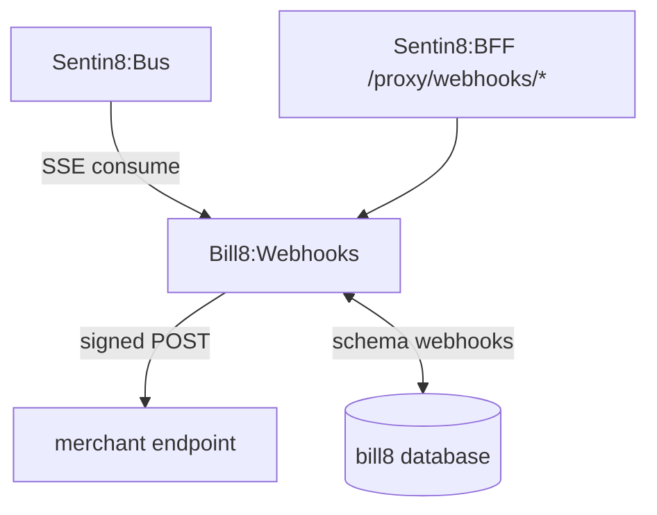
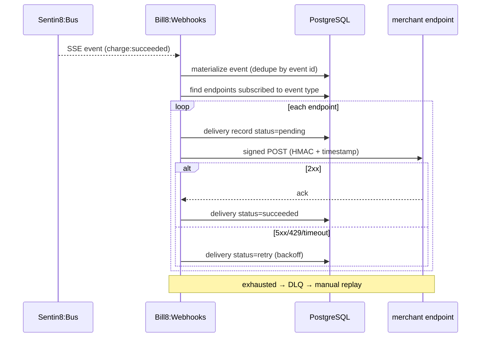
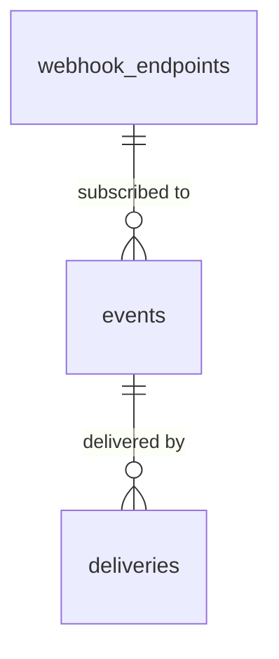
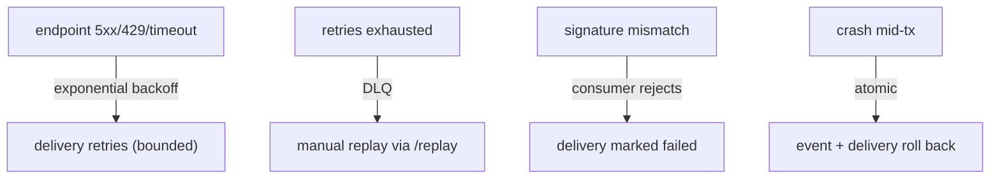
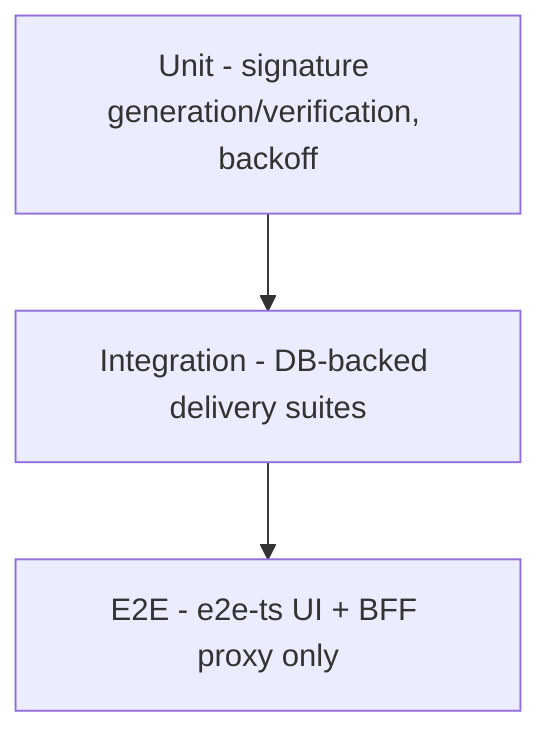

# Bill8:Webhooks - Detailed Design Document

## 1. Scope & Context

Bill8:Webhooks owns: the webhooks domain schema (domain tables + the
leaf schema `webhooks` for outbox/audit journal), the webhook-endpoint /
event REST API, the event-materialization consumer, the signed-delivery
engine with retry, and the `bill8:webhooks:*` event family.

It does NOT own: the domain events themselves (emitted by the owning
services), or event transport (Sentin8:Bus delivers; webhooks consumes
and forwards).

## 2. Runtime Architecture

Shell-booted; `build_state` adds config, Bus client, AppState, and the
consumer loop over domain families (`payments`, `billing`, `ledger`,
`merchants`, `checkout`, `risk`, `reporting`).

**Delivery lifecycle**:

## 3. Data Model

| Table | Purpose |
|---|---|
| `webhook_endpoints` | Merchant URLs + signing secrets (secret-by-reference) |
| `events` | Materialized domain events (envelope + payload) |
| `deliveries` | Delivery attempts with status/retry count |

**Producer tables** (platform contracts, `webhooks` leaf schema):
`webhooks.outbox` (DBX producer path - architecture-principles §6.7)
and `webhooks.audit_journal` (the 15-column contract of
`sentin8_audit::audit_journal_sql`, AUDJOUR-1 - env-pinned RLS, drained
to Sys `POST /v1/audit` by the shell's boot-8c pusher).

## 4. API Surface

| Endpoint group | Prefix | Authorization | Events |
|---|---|---|---|
| Endpoints | `/v1/webhook-endpoints` | `bill8:webhooks:endpoints:{read,write}` | `webhook_endpoint:created/updated/deleted` |
| Events | `/v1/events` | `bill8:webhooks:events:read` | - |
| Replay | `/v1/events/{id}/replay` | `bill8:webhooks:events:write` | - |
| Internal | `/v1/internal/*` | M2M | - |

## 5. Cross-Cutting Concerns

- Shield-gated; `env_id` RLS.
- Certificate identity (CERTFREE-4V) (`webhooks`, `webhooks-policy`, `webhooks-audit`).
- HMAC signing per endpoint; timestamp in the signature prevents replay.
- Dedupe by event id; deliveries idempotent.

## 6. Failure Modes & Recovery

## 7. Concurrency & Performance Model

- Pool cap 3; a bounded worker pool delivers events concurrently.
- Delivery uses async HTTP with a timeout; backoff is exponential.

## 8. Invariants, Insecure-Defaults Rejected, Unsafe Rationale

- Every delivery is signed; an unsigned payload is rejected by consumers.
- An endpoint receives only its enabled event types.
- Signing secrets are secret-by-reference, never plaintext.
- `#![forbid(unsafe_code)]`.

## 9. Testing Strategy

## 10. Open Questions

- See `backlog.md` `WH-*`.

---

**Design attribution:** bill8:webhooks and its underlying concepts were designed by Hamid Jahanzad <Hamid@Jahanzad.com>.
