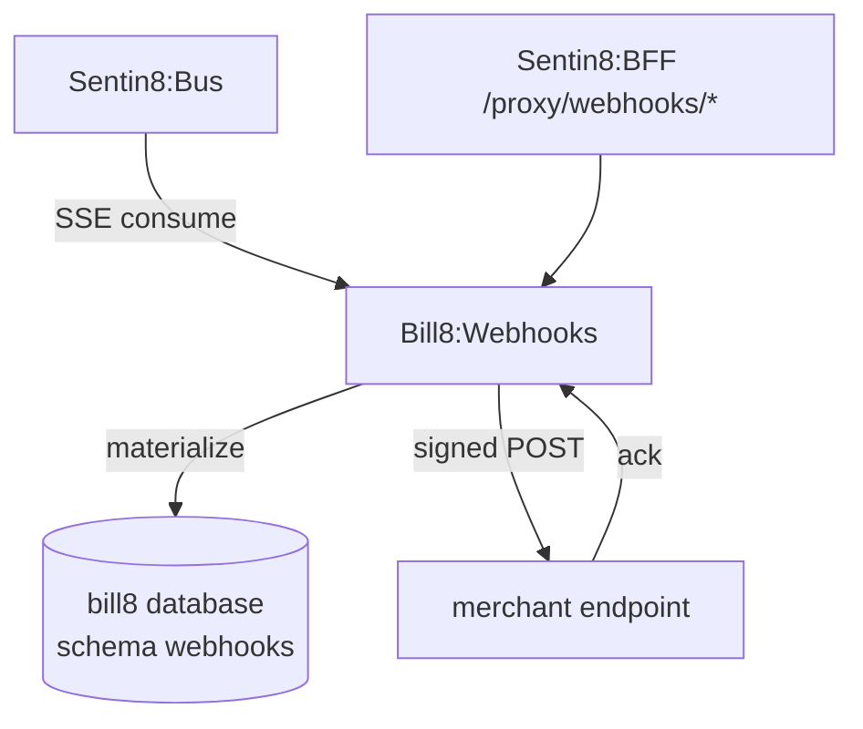

# Bill8:Webhooks — Event Delivery

Event materialization, endpoint management, and signed delivery.

## 1. Summary

Bill8:Webhooks owns the outbound integration surface: it consumes
domain events from Bus, materializes typed events, and delivers signed
payloads to merchant-configured endpoints with retry.

## 2. Motivation

Merchants integrate by receiving events. Centralized signed delivery with
retry and replay gives every event a durable, verifiable path to its
consumer, and keeps signing/retry logic out of domain services.

## 3. Architecture & High-Level Design

## 4. Key Traits and Data Structures

- `WebhookEndpoint` — a merchant-configured URL with a signing secret and
  enabled event types.
- `Event` — a materialized domain event with an envelope
  (`id`, `type`, `data`, `created`).
- Delivery is HMAC-signed with the endpoint's secret; a delivery has a
  status and retry count.

## 5. Rationale, Trade-offs, and Alternatives

- **Signed delivery with a per-endpoint secret** over shared tokens: a
  compromised endpoint secret is scoped to that endpoint.
- **Retry queue with exponential backoff** over best-effort: delivery is
  durable until acknowledged or exhausted.
- **Event materialization** over direct relay: materialized events are
  replayable and deduplicable.

## 6. Internal Implementation & Invariants

- Every delivery is signed; an unsigned payload is rejected by consumers.
- Retries follow exponential backoff; exhausted deliveries land in a DLQ.
- An endpoint receives only its enabled event types.

## 7. Unresolved Questions / Future Designs

- See `DESIGN.md` §10.

---

**Design attribution:** bill8:webhooks and its underlying concepts were designed by Hamid Jahanzad <Hamid@Jahanzad.com>.
